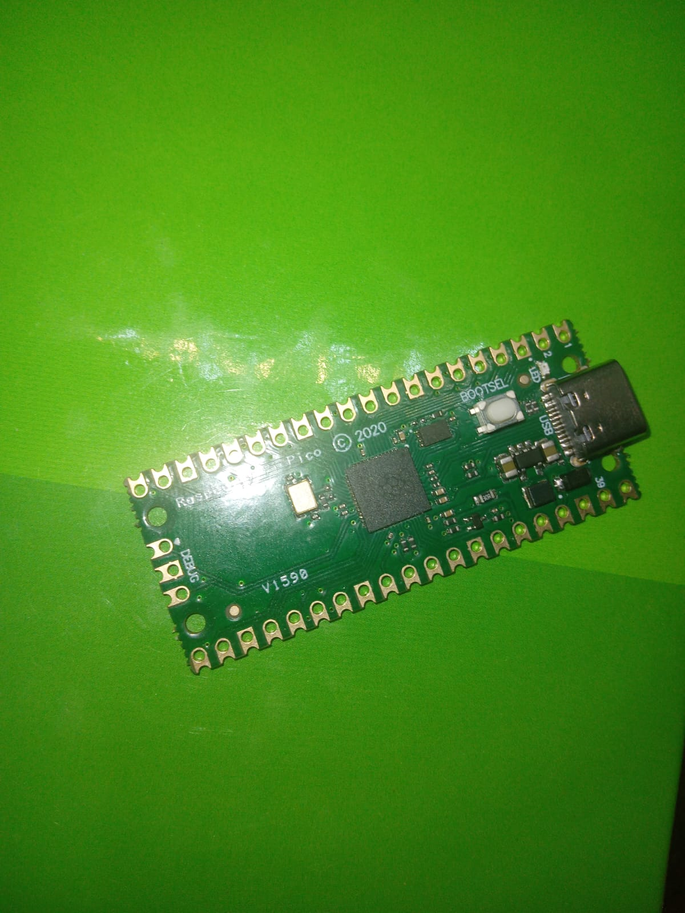
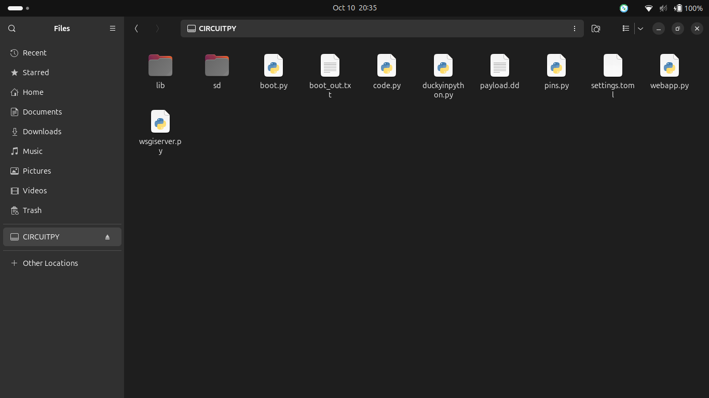
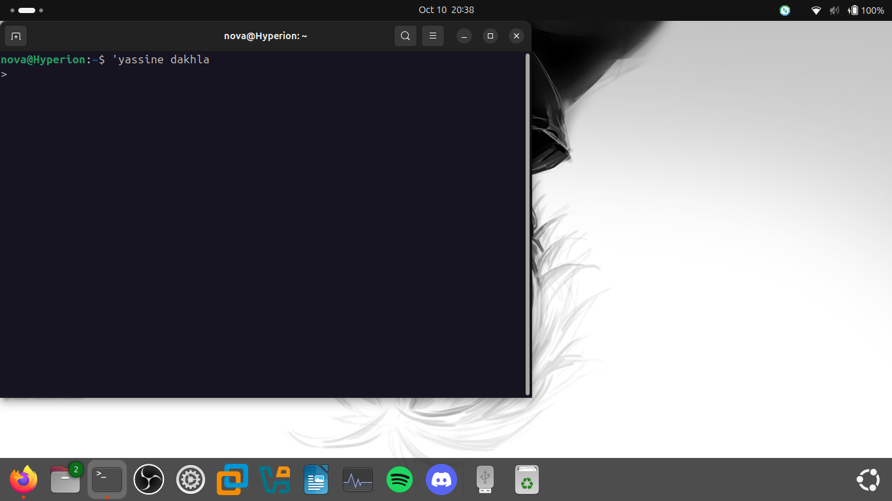

# Raspberry Pi Pico Ducky Lab

A hands-on cybersecurity lab exploring USB HID attacks and the security risks associated with USB devices that emulate a keyboard.

Built using an original Raspberry Pi Pico, CircuitPython, and the [dbisu/pico-ducky](https://github.com/dbisu/pico-ducky) project.

## Cybersecurity Learning Objectives

- Understand USB HID keyboard emulation.
- Learn how a USB device can simulate keyboard input.
- Explore the security risks of untrusted USB devices.
- Understand why physical access and device trust matter in cybersecurity.

## Hardware

An original Raspberry Pi Pico used for the lab.

## Configuration

The files stored on the Pico for the demonstration.

## Practical Test

The Pico was connected over USB and successfully demonstrated keyboard emulation by opening a terminal and typing my name.

## Security Relevance

This project demonstrates how a device disguised as a keyboard can generate input on a connected computer. It highlights the importance of physical security, controlling access to USB ports, and never connecting untrusted devices.

## Safety

All tests are conducted on systems I own or have permission to use. This project is for educational purposes.

## Reference

[dbisu/pico-ducky](https://github.com/dbisu/pico-ducky)
